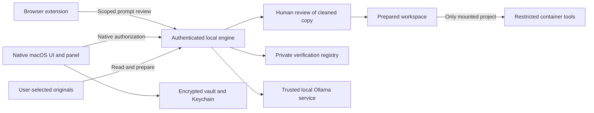

# ShareSafe Apple MVP specification

Version 0.1 · 10 October 2026 · target: macOS 14+

## Product purpose

ShareSafe helps someone prepare a prompt, document, screenshot or coding project before handing it to an AI platform. It runs a local review, exposes source evidence, applies explicit privacy policies and creates a new reviewed output. The desktop app stays available from the menu bar. A browser extension and a floating native panel bring the prompt review decision into the user’s existing workflow.

For coding work, the MVP prepares a separate synthetic project copy, then gives a managed local agent tools inside a restricted container. Original project folders and private verification mappings remain outside that container. The aim is to preserve enough project structure for useful development while withholding supported detectable secrets and supplied private terms.

This is a macOS desktop product. iPhone and iPad support are not part of this implementation: desktop Accessibility overlays, Docker workspaces and browser extension packaging have different constraints there.

## Primary users and useful outcomes

| User | Input | Outcome |
|---|---|---|
| Student or researcher | A prompt, document or screenshot | A reviewed text or image copy with supported identifiers masked |
| Professional | A prompt with private workflow names | A consistent generic description preserving the sequence of work |
| Developer | A project and an agent task | A reviewed project substitute with cleaned paths, contents and prompt |
| Developer using the managed agent | A prepared sandbox | Read, write and command tools confined to the mounted copy, with verification reports |

## Desktop interface

The main window has six pages. **Review** owns prompt/document/image analysis; **Agent Workspace** prepares the project copy; **Sandbox** verifies and runs the managed agent; **Vault** stores reviewed encrypted exports; **Activity** exposes audit counts; **Settings** controls monitoring, app selection, pairing and login launch.

The menu bar provides Open ShareSafe, Review clipboard, the prompt-monitor toggle and Quit. Clipboard content is read only after the user selects Review clipboard or Paste clipboard. Closing the window does not quit the background app. Launch at login is an explicit setting using macOS `SMAppService`.

## Review and policy features

Inputs are pasted text, TXT, Markdown, CSV, JSON, DOCX, text-bearing PDF, PNG, JPEG and WEBP. Documents up to 12 MiB and extracted text up to 200,000 characters are supported. PDFs are limited to 100 pages. Screenshots are limited to 16 million pixels.

Supported detection categories are email, Indian mobile-number candidates, Aadhaar-shaped candidates, PAN syntax, labelled bank accounts, Luhn-valid card candidates, credentials, explicitly labelled people and addresses, financial values and confidentiality indicators. Credential patterns include labelled assignments, several token prefixes, private-key blocks and JWT-shaped values. These are candidate patterns, not identity validation or proof of secrecy.

The user chooses one policy per category: **Allow**, **Warn**, **Mask**, **Generalize** or **Block**. Credentials default to Block in the full native review. Confidential and financial findings default to Generalize; the other categories default to Mask. Quick prompt review uses credential masking so the user can prepare a substitute inline.

Each finding includes its exact source span, category, action, detector and reason. The Source highlights tab shows the full extracted source with colored spans and category/action tooltips, using Unicode scalar-to-UTF-16 offset conversion. The user can select or retain findings, but Block findings cannot be bypassed through a selection toggle. Export refuses blocked results, a failed requested model check, or retained risks without explicit acknowledgement. Stable placeholders consistently replace repeated values within the reviewed content.

The workflow glossary maps private phrases to readable generic phrases. It rejects ambiguous or unsafe replacements. A separate button applies that glossary to browser and native quick prompt review for the current service session. Project preparation uses a separate identifier-safe glossary because filenames, imports and code identifiers have stricter requirements than prose.

Source edits and policy changes invalidate the current native review. In-flight results are discarded if their input generation changed. Document sessions expire after 30 minutes; the engine holds at most ten sessions. Project review plans expire after 30 minutes and are limited to three. Clear review removes the current document session. Clear all in-memory reviews removes document sessions and project review plans.

## Graph and local AI

The existing lightweight graph index is retained: entity co-occurrence, explicit alias relationships, source provenance, connected-component communities, extractive community reports and lexical seed retrieval with one-hop graph expansion. The graph page visualizes up to 24 entities at once and exposes the complete graph/report data in a detail view.

Evidence questions retrieve exact source chunks. Optional local-model answers must name an existing source and quote an exact source substring. Unknown questions can abstain. Co-occurrence alone does not imply confidentiality. Rule confidence and graph links are heuristic evidence rather than calibrated probabilities.

Optional semantic detection uses an installed Ollama model on a loopback port. All supplied model findings require exact contiguous source quotes and a recognized category. Invented quotes and unsupported responses are rejected. A requested model failure makes the review non-exportable. Quick browser/app reviews deliberately use rules and graph checks for predictable latency.

Prompt optimization adds the existing deterministic grounding instruction scaffold and trims outer whitespace. It does not invent a rewritten factual answer or claim that a remote model optimized the content.

## Documents, images and exports

DOCX text extraction covers body paragraphs, table-cell paragraphs and paragraph text from headers/footers. PDF input extracts available text and reports pages without text. The output is a new text-only TXT, DOCX or PDF; original images, comments, attachments, hidden source data, metadata and layout are not carried into that output. Scanned PDFs without text are rejected rather than approved as empty clean documents.

Native screenshot OCR uses Apple Vision against the same normalized PNG pixels passed to the backend. Unicode scalar offsets and rectangle coordinates are validated at the bridge. The MVP masks complete recognized lines intersecting findings, which can redact more than the matched word. OCR failure leaves manual review available.

The image page shows automatic rectangles and permits manual drag rectangles and Undo. Changing a finding or rectangle clears the full-image acknowledgement. Export requires an explicit statement that the complete image was reviewed. The exported PNG contains permanent black pixels and drops source metadata. Rectangles are not removable PDF annotations or separate layers.

The vault stores only explicitly saved reviewed exports. CryptoKit AES-GCM encrypts both content and the export name. A 256-bit device key is held in macOS Keychain using `AfterFirstUnlockThisDeviceOnly`; entry IDs are authenticated with the encryption. Vault files are outside agent workspaces. Decrypt and export asks the user for a destination. Losing the Keychain key prevents restoration from ciphertext alone.

## Browser workflow

The extension is installed separately and paired with the browser-only token copied from Settings. The native token is never given to the extension. Known domains are `chatgpt.com`, `chat.openai.com`, `claude.ai`, `gemini.google.com`, `chat.deepseek.com`, `chat.z.ai` and `z.ai`. Additional HTTPS origins require permission from the extension popup.

The content script tracks supported editable composers. It catches plain Enter, recognized Send/Submit buttons and ordinary form submissions, pauses the action and displays **Clean this prompt?** in an isolated shadow-root overlay. Shift+Enter remains available for multiline writing. Password fields and search fields are excluded from eligible editors.

The user can review locally, inspect prepared text, explicitly use it and press Send again. Replacement succeeds only if the draft still equals the captured input and the editor accepts the replacement. A one-use approval is tied to the editor, exact text and a short expiry; edits require another review. Failed pairing or local scanning leaves the intercepted send paused. The user can deliberately acknowledge privacy risks and keep the original once. Nothing is auto-submitted by ShareSafe.

Original file selection is paused for separate app review. The user imports the file into ShareSafe, exports the inspected copy and explicitly chooses that reviewed attachment. The extension does not inspect all attachment bytes, validate that an attachment was actually cleaned, or rewrite uploaded PDFs itself.

This integration covers supported DOM/editor events. Provider pages change. Closed application-controlled shadow trees, cross-origin frames, canvas editors and unusual Send mechanisms may need site-specific support. A browser extension is an advisory workflow aid, not a universal network-level data-loss prevention system. Other custom HTTPS AI platforms can be enabled, but their composer compatibility still requires checking.

## Native app overlay

Prompt monitoring is opt-in and requires Accessibility permission. The Settings allowlist contains bundle IDs; initial entries cover the expected ChatGPT and Claude desktop identifiers, and running app IDs are visible for adding other wrappers. Browsers use the extension to avoid duplicate native monitoring.

The monitor polls only the enabled frontmost app. It excludes secure text fields and requires an editable Accessibility value between 8 and 200,000 characters. After the draft stabilizes, a floating nonactivating panel offers a local review. It shows prepared text and an explicit Replace prompt or Copy prepared action.

Replacement checks the original Accessibility value before writing and verifies the resulting value afterward. The user still chooses when to send. The same captured draft is not offered again automatically; dismissal also delays offers for newly changed drafts for 20 seconds. This does not install a global keyboard hook or inspect every application. Editors that do not expose readable/writable Accessibility values use explicit clipboard review. Editable fields in an enabled app can produce an offer even if they are not its primary composer.

## Project copy preparation

The user selects an ordinary project folder, supplies private identifier replacements and writes an agent task. The engine inventories it without executing project code, installing dependencies or asking a model to interpret repository instructions.

Private/generated directories, version history, agent configuration, environment files, key material, databases, logs, encrypted artifacts, generated minified files and unsupported binary assets are omitted. Links are not followed. Supported UTF-8 source/text files are bounded to 512 files, 12 MiB total, 200,000 characters per file and two million characters total; the inventory is capped at 5,000 entries. A source inside ShareSafe storage, or a source containing that storage, is rejected.

The preparation pipeline replaces supported credentials, endpoint values, host paths and mapped identifiers consistently across file contents, sanitized relative paths, code imports and the task prompt. Swift, plist, Xcode configuration/project files and Metal source are supported as text alongside common web/backend languages. Explicit aliases can propagate across files. Unsafe paths, collisions after renaming, damaged Python/JSON syntax and detectable residual risks stop preparation. Other languages retain a clear unchecked syntax status.

The UI shows the sanitized task, all included file contents, syntax results, exclusion counts and warnings. Creating a sandbox or exporting its ZIP requires a strict review confirmation. The actual export data and metadata are rescanned before release. Original files and original filesystem metadata are not repackaged into the copy. Unsupported assets are excluded instead of being falsely certified safe.

## Agent sandbox and execution

Creating the sandbox materializes only the prepared UTF-8 files, a cleaned task and guidance in a randomly identified private storage folder. The private verification registry retains known original values and allowed dummy replacements outside the mounted copy.

Every managed command runs through an explicitly local Docker socket. A saved remote Docker context and inherited `DOCKER_HOST` are not used. Docker execution has no host-shell fallback. The image must already be present; execution uses `--pull never`.

The container receives one bind mount: its prepared `/workspace`. It has no original project mount, home-directory mount, Keychain mount, credential environment, private-registry mount or Docker-socket mount. Networking is disabled; the root filesystem is read-only; Linux capabilities are dropped; privilege escalation is disabled; the agent uses the Mac user’s non-root UID/GID. Limits include one CPU, 512 MiB memory, 64 processes, 128 open files, a 12 MiB individual-file limit and a 128 MiB temporary filesystem. Container logging is disabled.

The command UI accepts a JSON argument array. Commands have a 60-second limit and 24,000-byte output limit; output flooding stops the client/command path and the controller removes the named container. A workspace cannot run two managed jobs simultaneously. Verification runs before and after execution. Newly detected sensitive content, supplied original terms, binary output, links, non-regular files or files beyond verification limits quarantine the copy.

The local coding agent uses an installed Ollama model and up to eight steps. Its tools read a relative file, write a complete relative UTF-8 file, run an argument-array command inside the existing restricted container, or finish with a summary. Write proposals are scanned before execution. Tool output is bounded and scanned before being returned to the model. Verification runs before each model request and after the run; unsupported tool requests fail. The model sees the cleaned task and prepared file inventory, never the original source or private mapping.

Initial container image building can download Python image layers, Node and Git. Agent execution is offline; package installation and remote agent APIs are not supported. The restricted image contains Python, Node and Git for practical local tasks. It can edit prepared Swift sources but cannot compile AppKit/SwiftUI inside its Linux container; native builds require the reviewed Mac build step. Missing project dependencies can make a prepared copy unable to execute fully; the agent must report actual results instead of inventing a pass.

This isolation applies to ShareSafe’s managed execution path. A separately installed desktop agent running as the host user retains its normal host permissions. Host users/administrators can access ShareSafe storage; a directory is not magically exclusive to agents. Docker’s daemon and virtual machine are trusted components. Unknown secrets, malicious container escapes, host compromise and full aggregate disk quotas are outside the scanner’s assurance.

## Local audit and retention

The audit records timestamps, event names, finding/export counts, model states, sandbox verification state and executed tool step counts. It excludes prompt text, original file paths, private term maps and raw finding values. The Activity page displays the latest 100 events. Review raw content stays in bounded service memory until expiry, explicit clearing or process termination.

Prepared sandboxes and their private registry persist locally until the user deletes them. Deletion requires a selected workspace and confirmation, refuses running jobs and resolves its path inside managed storage. The source project is never deleted through this action. Browser tokens and the registry use user-private filesystem permissions; same-user host malware is outside that boundary.

## Definition of done and current status

Portable engine behavior, real HTTP authorization, exports, replica checks, sandbox command configuration and real-browser synthetic composer behavior are testable in this workspace. Their measured results are saved separately with timestamps and skipped/failure counts. Mock permission transports are explicitly identified.

A validated Mac MVP additionally requires: a successful Swift release build; a usable packaged engine; native screen inspection; Accessibility denial/grant behavior; correct native draft replacement; Vision pixel/offset checks; Keychain vault round trips; login/background lifecycle checks; Safari wrapper compatibility; and actual container tests proving the mounted copy is isolated. Those items remain pending on a Mac, not counted as local passes.

The acceptance sequence and distribution requirements are in `MAC_ACCEPTANCE.md`. App Store distribution, Developer ID notarization, a universal binary, arbitrary app/editor coverage, remote coding agents, scanned-PDF OCR and automatic reintegration of agent edits into the original project are later work.
