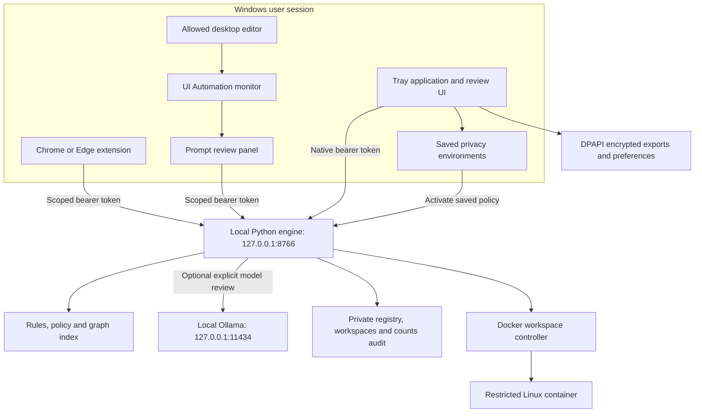
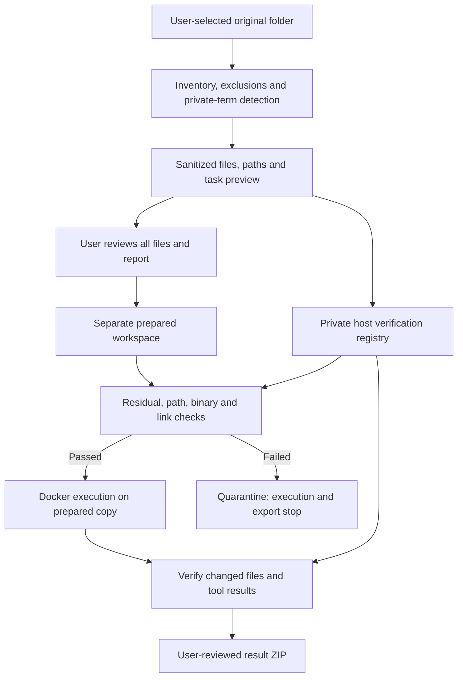

# ShareSafe for Windows: end-to-end architecture

Version 0.2 development port, 12 November 2026. This document describes the actual Windows source and distinguishes implemented behavior from acceptance work that remains.

## 1. Product and deployment

ShareSafe runs in the signed-in user's desktop session as a notification-area application. It owns a hidden local Python engine, uses a Chromium extension for browser composers, and offers an advisory floating panel for accessible editors in explicitly enabled desktop applications. Users can create privacy environments, review documents and screenshots, prepare sanitized project copies, and execute a managed local coding agent inside restricted Docker Linux containers.

The Windows desktop is C# WinForms on .NET Framework 4.8, targeting x64. The implementation deliberately uses the compiler available with Windows .NET Framework rather than requiring the .NET SDK. The existing SwiftUI macOS app is retained in `NativeApp`; it is not used on Windows. Both platforms share the Python engine, browser extension, project preparation and container tools.

The normal deployment has no privileged Windows service. The tray application operates after sign-in; closing its window keeps it running. It does not monitor the desktop before sign-in, after sign-out, on the secure desktop, or inside another user's session. Windows services run in a separate session and are unsuitable as the UI overlay process. A future enterprise service would require a separate authenticated per-user companion.

## 2. System topology



The engine is trusted with user-selected originals. The extension has review-only authorization. The managed agent receives only a reviewed substitute project. The private registry remains on the host outside the container mount.

## 3. Source ownership

| Component | Source | Responsibility |
|---|---|---|
| Application entry and tray lifetime | `WindowsApp/Program.cs` | Single instance, wake existing window, tray menu, hidden startup, shutdown |
| Review and workflow screens | `WindowsApp/MainWindow.cs` | Review, environments, project preparation, sandbox, vault, activity and settings |
| Engine client and Windows private storage | `WindowsApp/Runtime.cs` | Engine process, HTTP authorization, DPAPI, user/SYSTEM directory ACL |
| Desktop prompt overlay | `WindowsApp/PromptMonitor.cs` | Foreground-process allowlist, UIA capture, stable draft checks, floating review, safe replacement |
| Image review and OCR adapter | `WindowsApp/ImageReviewWindow.cs` | Image normalization, native OCR invocation, manual rectangles, full-image review confirmation |
| Native OCR bridge | `scripts/windows-ocr.ps1` | Windows.Media.Ocr, recognized words, pixel coordinates, Unicode scalar offsets |
| Chromium extension | `BrowserExtension/` | Page overlay, composer interception, service-worker transport, site permission and pairing |
| Authenticated local API | `backend/sharesafe_engine/bridge.py` | Request validation, token scopes, review sessions, audit events and application lifecycle |
| Detection and graph | `backend/sharesafe_engine/core.py` | Candidate patterns, policies, replacements, graph retrieval, local model evidence validation |
| Files | `backend/sharesafe_engine/files.py` | Input extraction, safe text exports and flattened screenshot redaction |
| Project preparation | `backend/sharesafe_engine/project.py` | Exclusions, consistent replacement of names/contents/paths/prompt, syntax and residual checks |
| Sandbox controller | `backend/sharesafe_engine/workspace.py` | Materialization, private registry, verification, container lifecycle, local agent, result ZIP |
| Agent tools inside container | `sandbox/workspace_tool.py` | Restricted read/write/run tools rooted in `/workspace` |
| Container image | `sandbox/Dockerfile` | Prepared Linux execution environment |
| Windows build | `scripts/build-windows.ps1` | Python environment, native compilation and optional PyInstaller bundle |

## 4. Startup, background operation and exit

1. `Start-ShareSafe.cmd` launches `WindowsApp/bin/ShareSafe.Windows.exe` without an attached console.
2. The app obtains a per-user named mutex. Launching again signals a named event to display the existing window rather than starting a second engine.
3. It creates `%LOCALAPPDATA%\ShareSafeWindows` with inherited permissions disabled and full control for the current Windows account and SYSTEM. Existing directory junctions are rejected.
4. DPAPI decrypts preferences for the current account. New installations generate two distinct cryptographically random 256-bit bearer tokens.
5. The app creates a short-lived engine startup configuration inside that private directory. The Python child binds only to loopback, using port 8766. The native client bypasses HTTP proxies and rejects redirects.
6. The app waits for an authenticated health response, then removes the startup configuration and activates the saved privacy environment. Source builds run `.venv/Scripts/python.exe`; packaged builds use the bundled engine executable.
7. Closing the main window hides it. The message loop, tray icon, local engine and enabled prompt monitor continue running.
8. The optional **Start when I sign in** setting creates only a current-user Run entry, passing `--background`. It is off until selected. No administrator elevation is required by ShareSafe itself.
9. **Quit ShareSafe** disposes the monitor and requests native-authorized engine shutdown. The engine cleans up active managed containers before exiting. There is a bounded forced-process fallback if graceful shutdown cannot complete.
10. If the desktop parent crashes, the engine's Windows watchdog waits on a SYNCHRONIZE process handle and initiates the same server cleanup. Holding a process handle avoids relying on a reusable numeric PID.

There is no automatic watchdog restart after an engine failure. Restart ShareSafe to recover. It does not install a machine-wide service or override Windows power/sleep policies.

## 5. Browser prompt workflow

1. Load the extension in Chrome or Edge and pair it using the browser token copied from Settings.
2. Known provider domains receive the content script. Additional HTTPS origins require an explicit per-site grant through the popup.
3. The script recognizes supported textareas/contenteditable composers and common Enter/click/form submission paths. It pauses recognized sends and displays a closed-shadow-root review overlay.
4. **Review locally** sends the captured draft to the extension service worker, which validates the sender, origin and permission before calling `/v1/browser/review`.
5. The engine applies the active inline policy using rules and graph checks. Inline model inference is disabled. Environment actions, including Block, are honored when supplied by the Windows app; legacy clients that omit actions retain their earlier credential-mask default.
6. The overlay displays the prepared draft. Replacement checks that the captured source still matches the current composer. Edits invalidate the result.
7. **Use prepared draft** updates the composer. The extension does not automatically submit it; the user sends on a subsequent action.
8. Attachment inputs are handled as a separate review workflow. Original attachments are not automatically rewritten. Users import/export a reviewed copy in the desktop app, then explicitly choose that copy.

The extension is an assistive workflow, not a universal browser egress firewall. Unsupported editor frameworks, programmatic sends outside recognized events, disabled extensions and other applications can bypass it. Keeping an original draft once requires an explicit acknowledged bypass in the existing extension. A policy Block prevents generation of an approved prepared output; it is not an operating-system-wide upload prohibition.

## 6. Native application prompt overlays

The monitor runs on its own background STA thread, polling approximately every 600 milliseconds. It reads only an explicitly allowed foreground process; the default allowlist is empty and monitoring defaults off. Browser processes are excluded from UIA monitoring because the browser extension provides origin-scoped coverage.

For an allowed editor, it verifies the focused UIA element belongs to the foreground PID, is enabled and visible, is Edit or Document, and is not marked as a password. It reads `ValuePattern` when available, otherwise `TextPattern`. A draft must be 8–200,000 characters and remain stable for approximately one second. Its process, UIA runtime identity, environment and contents determine the captured draft identity.

The floating panel appears near the editor without intentionally taking focus. **Review locally** calls the same scoped review API used by the extension. The user inspects the returned read-only text and explicitly chooses Replace or Copy.

Direct replacement requires a writable ValuePattern. Immediately before writing, ShareSafe rechecks the target PID, target window, non-password status, active environment and exact original value. It reads back the value to verify the write. If a provider exposes only TextPattern, the panel offers Copy instead; it does not simulate keystrokes or Send. Changed drafts or changed environments cannot be applied through that captured panel.

Desktop Send interception is not implemented. Elevated apps, protected controls, inaccessible Electron/webview editors and applications with incomplete UIA providers can be unreadable or unreplaceable. Allowing a process enables reading its accessible foreground editors, not just AI prompts, so allow only the applications intended for review. UIA providers can hang; their worker is isolated from the main UI thread, but a hung provider can stall monitoring until restart.

## 7. Privacy environments

An environment is a named saved configuration, for example Personal, Work or Research. It stores the review policy, allowed desktop executable names and a project-specific glossary. It is not a Python virtual environment, Windows user account or VM.

| Profile field | Behavior |
|---|---|
| Name | Unique human-readable name, 1–60 characters |
| Policy actions | Per category: allow, warn, mask, generalize or block |
| Confidential terms | Additional private phrases to find |
| Allowed terms | Reviewed allowances; credential policy retains engine safeguards |
| Prose replacements | Original phrase to reviewed readable phrase |
| Optional model | Local Ollama model name and full-review enable flag |
| Processes | Explicit executable names such as `Claude.exe`, one per line |
| Project glossary | Original term to safe code identifier, separate from prose replacements |

Create an environment, edit its configuration, then save it. Select another saved environment and press Activate to switch. Successful activation updates the inline engine policy, persists the selection, closes native overlays and invalidates native document/project reviews. The saved environment is reactivated on next launch. Inline checks remain deterministic rules/graph checks even when full document model review is enabled.

Profiles are user-managed, DPAPI-encrypted preferences. There is no implemented administrator role, organization policy server, per-site automatic environment selection, environment deletion UI, signed policy distribution or tamper-proof enforcement. In-flight browser reviews may belong to the policy active when their request began; re-review after changing environments.

Example full-review policy:

```json
{
  "actions": {"CREDENTIAL": "block", "EMAIL": "mask", "CONFIDENTIAL": "generalize"},
  "confidential_terms": ["PrivateWorkflow"],
  "allow_terms": [],
  "replacements": {"PrivateWorkflow": "generic workflow"},
  "use_model": false,
  "model": "qwen2.5:3b"
}
```

## 8. Review engine and local graph

The engine supports candidate detection for email, phone, Aadhaar-shaped values, PAN syntax, labelled accounts, card candidates with Luhn checks, credentials, explicitly labelled people and addresses, financial values and confidentiality phrases. These are heuristics, not validated identity or secrecy classifiers.

The policy resolves overlapping findings and assigns actions. Every finding includes an ID, category, exact source span, value, detector and reason. The Windows Findings grid exposes the selected actions and lets users retain findings where allowed. Block findings cannot be bypassed through an Apply checkbox. Retained risks require acknowledgement, and a failed explicitly requested model review prevents export.

The graph is a lightweight GraphRAG-inspired index: source chunks, entities, co-occurrence edges, explicit aliases, connected-component communities, extractive community reports, lexical seed retrieval and one-hop expansion. It is not a separate graph database or a trained knowledge graph model. Co-occurrence does not automatically spread confidentiality. The Windows evidence tab exposes the complete graph and source data and can query source chunks; this version displays the graph as structured data rather than the macOS graphical node view.

Optional Ollama inference runs on loopback. Original full-review content is sent to that trusted local process only when requested. Model suggestions must identify an exact source quote and a known category. Unsupported or invented evidence is rejected. The Windows evidence question action currently uses deterministic source retrieval; model-backed query capability remains available in the shared API.

Edits invalidate the native review. Sessions live in engine memory for at most 30 minutes, with at most ten document sessions and three project plans. Clearing reviews removes sessions/plans; it does not delete saved files, vault entries or materialized sandboxes.

## 9. Documents, OCR and export

Inputs are UTF-8 TXT, MD, CSV, JSON; DOCX; text-bearing PDF; and PNG/JPEG/WEBP. The limits are 12 MiB per input, 200,000 extracted text characters, 100 PDF pages and 16 million image pixels.

Windows OCR uses Windows.Media.Ocr through a noninteractive PowerShell helper. The app normalizes image orientation before OCR. The helper supplies exact word text, Unicode scalar offsets and pixel rectangles, which the engine validates. OCR depends on installed Windows English language support. Unsupported decoding or OCR failure falls back to manual full-image review; it is not silently treated as a clean image.

The image review dialog shows proposed redactions and supports additional drag rectangles and undo. Changing findings invalidates image-review confirmation. Export requires explicit full-image review and generates a flattened PNG with metadata removed.

Text/document outputs are newly generated TXT, DOCX or PDF copies. Original layout, images, comments, attachments and hidden source containers are not carried forward. Scanned PDF OCR and faithful editable-document layout preservation are not implemented. Prompt optimization adds deterministic grounding instructions; it does not call a cloud rewriting service.

## 10. Project preparation and sandbox lifecycle



Preparation does not run project code. It inventories at most 5,000 entries, includes at most 512 supported UTF-8 text files, and analyzes at most 12 MiB / two million characters. It excludes credentials/configuration artifacts, private keys, `.env` files, generated directories, binary content, unsupported file types and links/reparse points. Known terms and supported detectable secrets are replaced consistently across contents, paths and the task. Case-colliding and Windows-reserved names are rejected. Python/JSON syntax is checked only if the original parses; other languages require review and actual tests.

The preview is an in-memory plan. A separate prepared folder is created only after explicit review confirmation. The engine retains original values and allowed substitutes in a private registry used for residual scans; that registry is never mounted into the agent container. Preparation does not alter or delete the original folder.

**Sandbox creation** materializes and verifies a workspace. It does not keep an idle container permanently running. Running a command creates a short-lived container; running the managed local agent creates a bounded multi-step container session.

| Isolation/control | Actual configuration |
|---|---|
| Container runtime | Docker Desktop, Linux containers; local named-pipe endpoint explicitly selected |
| Network | `--network none`; no agent network or package downloads |
| Root filesystem | Read-only |
| Writable project | One bind mount: prepared workspace to `/workspace` |
| Temporary space | Size-limited `/tmp` tmpfs, nosuid/nodev/noexec |
| Privilege | Nonroot UID/GID, all capabilities dropped, no-new-privileges |
| Resource limits | 512 MiB memory, one CPU, 64 PIDs, bounded output/file size/open files |
| Host integration | No original-project mount, credential directory, Docker socket or inherited host secrets |
| Command input | JSON argument array, passed directly to the container process |
| Fallback | Missing Docker/image is an error; never execute the command on the Windows host |
| Verification | Before and after execution; detected residuals, links/reparse points, hard links and unscanned binary files quarantine the workspace |
| Result export | Explicit review, verification and content-hash recheck; ZIP contains workspace files only |

The host Docker CLI receives only an allowlisted environment needed to find Windows/Docker configuration. That CLI environment is not forwarded as container environment variables. `DOCKER_HOST` and saved remote contexts do not select a remote daemon.

At most three managed workspace operations run concurrently, and a workspace cannot run overlapping operations. A command has a 60-second limit with about 24 KB captured output. The managed local agent is bounded to eight steps and approximately eight minutes, with individual tool/model limits. Its tools are read, write, run and finish. The host orchestrator passes the sanitized task and allowed tool results to local Ollama. Proposed writes and changed files are checked for supported residual risks.

Windows directory junctions and other reparse points are rejected during verification without traversing their target. File hashes are checked again during result ZIP creation. These checks reduce file redirection risks; they are not protection against a separate malicious process running as the same Windows user.

Docker is the implemented isolation backend. Windows Sandbox `.wsb`, Hyper-V VM orchestration, AppContainer enforcement and arbitrary external-agent sandboxing are not implemented. An unrestricted Codex/other agent launched separately as the user can still access host files. Merely selecting a ShareSafe environment does not restrict that external agent.

## 11. Data and trust boundaries

| Data | Location / protection | Container visibility |
|---|---|---|
| Native and browser tokens, profiles, active environment | `preferences.dpapi`, current-user DPAPI plus directory ACL | None |
| Startup token configuration | Temporary private `engine-startup.json`, removed after startup attempt | None |
| Document text/findings/graph and project preview | Engine memory with session expiry | None unless explicitly included in prepared content |
| Original source projects | User-selected original location; read during preparation | Never mounted |
| Sanitized editable workspaces | `workspaces/<random-id>/` under private app data | Selected workspace only |
| Original-to-substitute verification information | `private-registry/<id>.json`, host ACL; currently plaintext JSON | Never mounted |
| Counts-only audit | `audit.sqlite3`, host ACL | None |
| Reviewed encrypted exports | `vault/*.dpapi`, current-user DPAPI | None |
| OCR temporary normalized image | Random PNG under private app data, removed after OCR attempt | None |
| User-exported files | Explicit user-selected location, normal plaintext output | Only if user later provides it |
| Browser pairing token | Browser extension local storage | None |

DPAPI protects stored preferences/vault entries for the Windows account; it does not isolate ShareSafe from other programs already running as that same account. Administrators, compromised dependencies, the local model and Docker Desktop are inside the trusted host boundary. The private registry and prepared workspaces are ACL-protected, not individually encrypted at rest. NTFS ACLs are the Windows storage boundary; POSIX mode bits are not relied on to provide Windows account isolation.

The browser token is intentionally weaker than the native token. The API validates Host, authorization, JSON type and size, and permitted extension origins. An ordinary website Origin is not accepted. Responses use no-store. The extension keeps its token out of page DOM, but a compromised extension or same-user process remains a risk.

## 12. API map

| Route | Authorization | Purpose |
|---|---|---|
| `GET /v1/health`, `/v1/status` | Native | Health; model/Docker diagnostics |
| `GET /v1/browser/status` | Browser | Pairing/availability check |
| `POST /v1/browser/review` | Browser | Inline deterministic review |
| `POST /v1/inline/policy` | Native | Activate inline environment policy |
| `POST /v1/analyze` | Native | Text/document/image session |
| `POST /v1/preview`, `/v1/export` | Native | Reviewed prepared text or file |
| `POST /v1/query` | Native | Source-backed graph retrieval, optional model answer in API |
| `POST /v1/forget`, `/v1/clear` | Native | Invalidate review sessions/plans |
| `POST /v1/project/prepare`, `/v1/project/export`, `/v1/project/forget` | Native | Project plan and pre-agent handoff ZIP |
| `GET /v1/workspaces` | Native | Materialized workspace list |
| `POST /v1/workspace/create`, `/verify`, `/run`, `/agent`, `/export`, `/delete` | Native | Sandbox lifecycle; suffixes share `/v1/workspace` |
| `GET /v1/audit` | Native | Latest 100 count-based events |
| `POST /v1/shutdown` | Native | Graceful owned-engine exit |

## 13. Failure behavior and operational limits

Missing model: deterministic review still works; an explicitly requested model failure prevents approval/export. Missing Docker: preparation and review still work; execution fails without host fallback. Unsupported desktop control: copy/manual review remains available. Changed draft: captured replacement is rejected. Expired session: analyze/prepare again. Unscanned binary or residual private value: sandbox quarantine. Engine crash: overlays cannot approve a result and the user restarts the app.

This version has no signed installer, signed automatic update channel, production crash reporter, enterprise policy service, high-availability engine supervisor or universal outbound DLP driver. The optional PyInstaller packaging path is provided, but a self-contained release must be built and tested separately. Build dependencies and Docker image construction may require internet access. Runtime review does not require a cloud service; Ollama and Docker are optional local dependencies for their respective features.

## 14. Measured validation and remaining acceptance

The Windows C# application compiled locally. Direct desktop testing verified opening, authenticated local analysis, email/person masking, prepared preview, encrypted vault entry creation and closing/reopening the same background session.

`tests/results/windows-restricted.json` records 150 checks: 149 passed and one skipped because this managed execution host prohibits creating hard links. These cover portable review/file/project logic, in-memory HTTP request handlers, workspace configuration/export and actual Windows parent-process-handle cleanup. They are not real TCP or actual Docker isolation checks.

The shell runner blocks even loopback connections with WinError 10013. Its real HTTP attempt is preserved separately in `windows-tcp-restricted.json`; the native self-test records four successful DPAPI/profile checks before its engine connection was blocked. These restricted-runner failures are not relabelled as passes. The direct desktop application, launched in the interactive session, did communicate successfully with its local engine.

Docker's Linux daemon was unavailable. Real sandbox isolation, local model execution, Windows OCR acceptance, startup-at-login behavior and application-specific desktop overlay capture/replacement remain to be exercised using `WINDOWS_ACCEPTANCE.md`. The browser extension retains the previous portable implementation with platform-neutral manifest wording; its real-browser suite was not re-certified in this restricted run. The native UI additions made after the first desktop smoke test were recompiled and covered where applicable by the engine tests, but still need the full manual acceptance pass.

## 15. Platform reference sources

- [Windows Forms NotifyIcon](https://learn.microsoft.com/en-us/dotnet/desktop/winforms/controls/notifyicon-component-windows-forms): tray process UI.
- [UI Automation ValuePattern.SetValue](https://learn.microsoft.com/en-us/dotnet/api/system.windows.automation.valuepattern.setvalue?view=netframework-4.8): direct value replacement and read-only limitations.
- [UI Automation text insertion](https://learn.microsoft.com/en-us/dotnet/framework/ui-automation/add-content-to-a-text-box-using-ui-automation): different editor pattern support.
- [ProtectedData / DPAPI](https://learn.microsoft.com/en-us/dotnet/api/system.security.cryptography.protecteddata?view=netframework-4.8): current-user data encryption.
- [Interactive services](https://learn.microsoft.com/en-us/windows/win32/services/interactive-services): user-session UI and service separation.
- [Docker Desktop Windows requirements](https://docs.docker.com/desktop/setup/install/windows-install/) and [WSL backend](https://docs.docker.com/desktop/features/wsl/): supported host and virtualization prerequisites.

ShareSafe-specific claims above come from the repository implementation and measured checks; the platform references do not certify this application's security or accuracy.
